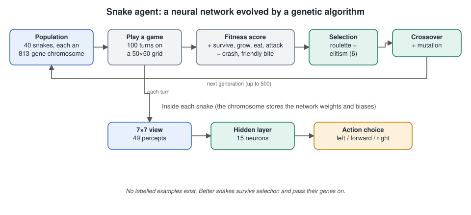

# Snake Genetic Algorithm Neuroevolution

## The problem

Two populations of snakes (40 per side) compete on a 50×50 grid for 100 turns. Each snake sees only a 7×7 window around its head, showing food, friends and enemies, and chooses to turn left, go forward or turn right. A good strategy survives, grows long, avoids biting teammates and attacks enemies. There are no labelled examples of good moves, so the agent has to discover a strategy by trial and selection.

## Architecture

## How the agent works

- **Controller.** A feedforward neural network takes the 49 percepts from the 7×7 view, passes them through one hidden layer of 15 neurons and outputs a probability for each of the three actions. All weights and biases are stored as one 813-gene chromosome.
- **Evolution, not backpropagation.** A genetic algorithm trains the population for up to 500 generations using roulette selection, single-point crossover, mutation and elitism (the six best snakes carry over unchanged).
- **Fitness function.** A hand-built score rewards survival, growth, eating and attacking, and penalises crashes, friendly bites and being bitten.
- **Baselines first.** A random-versus-random baseline was measured before any claim of improvement.

## Results

Over five random seeds the evolved agent averaged a score of about 120 against a random baseline of about 0, and won every evaluation game.

## Files

- [`project-report.pdf`](project-report.pdf): the strategy, the fitness design, the parameter experiments and the evaluation.

The source code is not included in this repository.

## Tools

Python · NumPy · genetic algorithms
