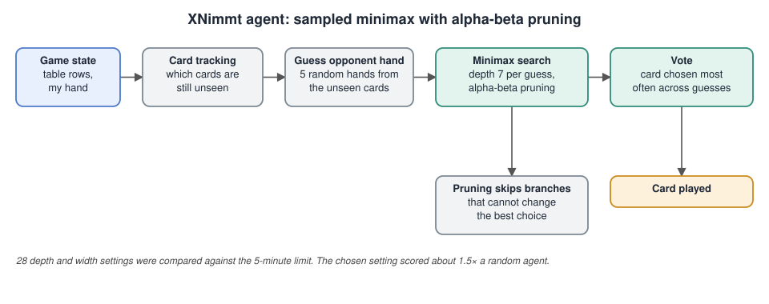

# XNimmt Minimax Alpha-Beta Agent

## The problem

XNimmt is a card game for two players. Both choose a card at the same moment, cards are then resolved one after another, and neither player knows the opponent's hand or the cards still to come. It is an adversarial search problem with hidden information and an element of chance, so a plain turn-taking game tree does not fit it directly. The agent has to pick the card that minimises the penalty it collects over the rest of the round, within a five-minute time limit.

## Architecture

## How the agent works

- **Minimax with alpha-beta pruning.** The agent searches future card plays to a fixed depth and prunes branches that cannot change the result.
- **Card tracking.** It records the cards already seen so it can reason about the cards still hidden.
- **Sampling the unknown.** The opponent's hand is guessed several times by drawing random hands from the unseen cards. Minimax runs on each sample and the agent plays the card chosen most often.
- **Tuned search settings.** 28 depth and width combinations were compared against the time limit. The chosen setting, depth 7 with 5 sampled hands, scored about 1.5 times a random agent and finished 100 games in under two minutes.

## Files

- [`minimax_agent.py`](minimax_agent.py): the agent.
- [`project-report.pdf`](project-report.pdf): the strategy, the evaluation results and the limitations. One limitation is that the search assumes the agent moves first.

The agent runs inside a game framework supplied with the course, which is not redistributed here.

## Tools

Python · pandas
