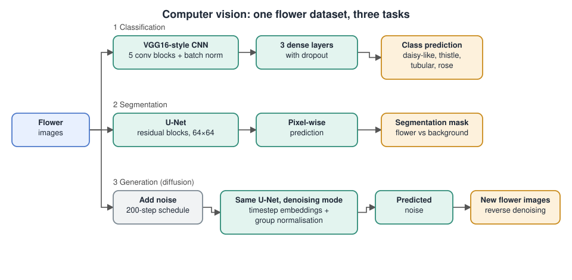

# Computer Vision: Classification, Segmentation & Generative Diffusion

## The problem

Three connected image tasks on a flower dataset, each solved with a neural network written in PyTorch:

1. **Classification.** Decide which of four flower groups a photo belongs to: daisy-like, thistles, tubular and roses.
2. **Segmentation.** Label every pixel of an image as flower or background.
3. **Generation.** Learn what flowers look like well enough to create new flower images starting from pure noise.

## Architecture

## What was built

- **Classifier.** A VGG16-style network with batch normalisation after each convolution, a three-layer dense head with dropout, weight decay and early stopping on validation loss. A weighted random sampler was tested as a way to handle uneven class sizes.
- **Segmentation model.** A U-Net with residual blocks working on 64×64 images.
- **Diffusion model.** The same U-Net, switched into a denoising mode with an `is_ddpm` flag. It predicts the noise added to an image, uses sinusoidal timestep embeddings inside the residual blocks, and swaps batch normalisation for group normalisation, which stayed stable in this setting. Training used a noise schedule with 200 steps, AdamW, cosine annealing, warm-up and gradient clipping.

## Results

| Task | Result |
|---|---|
| Classification | 85.6% accuracy on the natural class mix and 85.4% with the balanced sampler. The two are close, so the sampler is a design choice and not a proven gain. Roses recall dropped when balancing. |
| Segmentation | 91.3% pixel accuracy, 78.7% mean IoU, Dice 0.88. Most errors fall on flower boundaries. |
| Diffusion | 12 documented training runs. An early run collapsed to a grey blur. Recognisable flower shapes appeared in run 11, trained on a single-class subset at 128×128. |

## Files

- [`project-report.pdf`](project-report.pdf): the full write-up with architecture diagrams, confusion matrices and the diffusion run log.

The model source code is not included in this repository.

## Tools

Python · PyTorch · U-Net · DDPM
