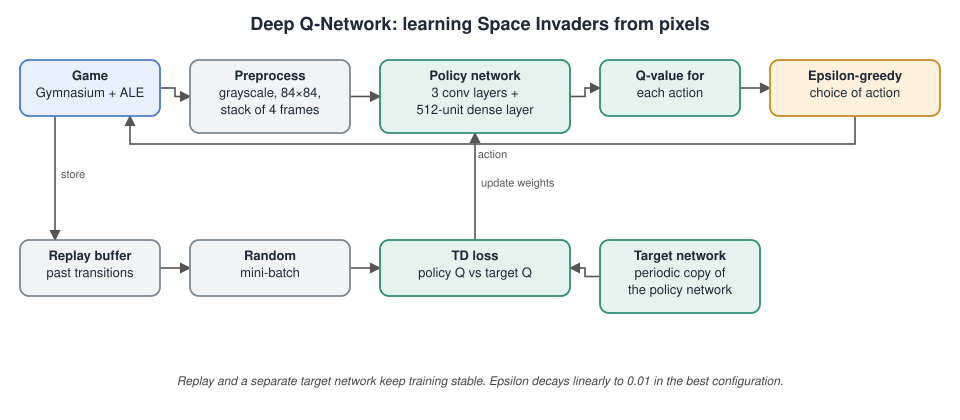

# Deep Reinforcement Learning for Atari Space Invaders

## The problem

Teach an agent to play Space Invaders using only what a human sees: the game screen and the score. There is no rulebook and no hand-written strategy. The agent learns which action to take in each situation by playing and receiving rewards.

## Architecture

## What was built

A Deep Q-Network following Mnih et al. (2015), implemented with PyTorch and the Gymnasium Arcade Learning Environment.

- Input: a stack of four grayscale 84×84 frames, so the network can see motion.
- Network: three convolutional layers and a 512-unit dense layer that estimates the value of each possible action.
- Stabilisation: an experience replay buffer, a separate target network, gradient clipping and a linearly decaying epsilon-greedy exploration rate.
- Tuning: eight hyperparameter configurations were compared. The best used batch size 64, learning rate 2.5e-4 and a final epsilon of 0.01.

## Results

- Training ran for about 400,000 steps, short of the 1,000,000 target because of GPU limits.
- Average training reward rose from about 150 to about 260 against a random-policy baseline of about 130.
- Evaluation averages of 248 to 286 give roughly twice the reward of the random baseline.
- The report's analysis describes the learned behaviour candidly. The agent shoots and takes cover, and it does not yet chase the high-value targets.

## Files

- [`project-report.pdf`](project-report.pdf): the full write-up with the network design, the reward curves and the behaviour analysis.

The training source code is not included in this repository.

## Tools

Python · PyTorch · Gymnasium · Arcade Learning Environment
