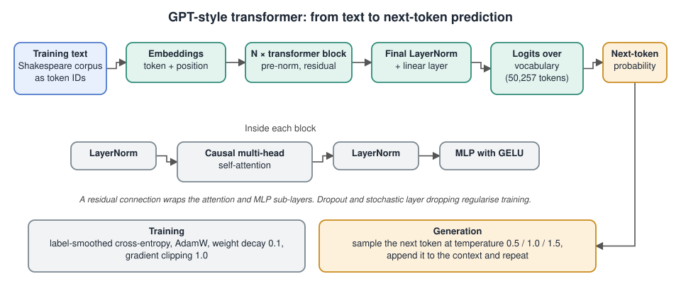

# GPT-Style Transformer for Language Modelling

## The problem

Given a short window of text, predict the next token. Repeating that prediction one token at a time lets the model write new text. This project builds the whole model from first principles and trains it on a small Shakespeare corpus, so the goal is to understand how a GPT-style network works and what makes it train well on little data.

## Architecture

## What was built

- A decoder-only transformer in PyTorch with token and positional embeddings, pre-norm residual blocks, multi-head causal self-attention and GELU MLP layers, followed by a projection to vocabulary logits.
- Regularisation controls: attention and MLP dropout, stochastic layer dropping, weight decay, label smoothing and gradient clipping.
- A training-batch builder that produces inputs and next-token targets shifted by one position.
- Automated checks for the properties a transformer should have:
  - input and target shift alignment
  - permutation equivariance when positional embeddings are absent, and its loss when they are added
  - causal masking, so outputs ignore future tokens
  - output shape of batch × length × vocabulary

## Training and results

- More than 50 configurations were run, varying depth, attention heads, embedding size, context length, batch size and learning rate.
- The best configuration reached a validation loss of 3.83.
- Small models memorise the corpus quickly, so regularisation and training stability mattered more than model size. Adding attention heads did not improve generalisation on a dataset this small.
- Very deep configurations (32 layers) failed to converge at all, which the report records as a finding.
- Sampling temperature (0.5, 1.0, 1.5) was swept and the generated text analysed. The report compares how style and coherence change across the three settings.

## Files

- [`project-report.pdf`](project-report.pdf): the full write-up with verification outputs, experiment tables and generated samples.

The model source code is not included in this repository.

## Tools

Python · PyTorch
