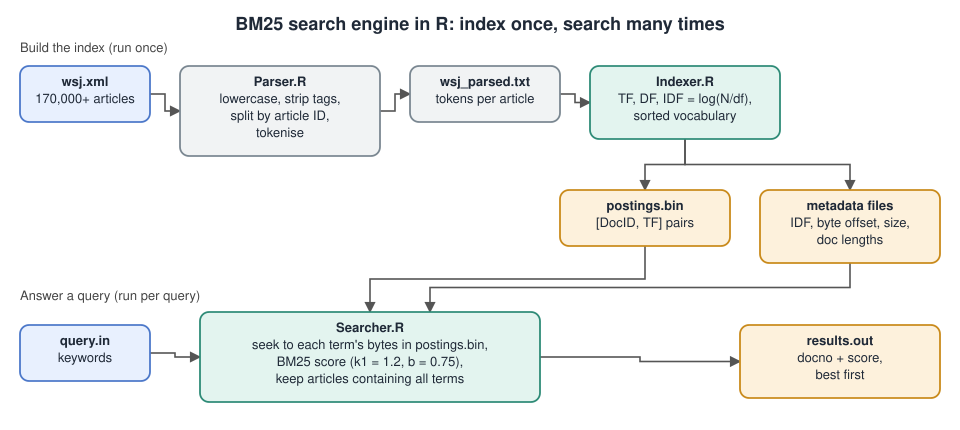

# BM25 Search Engine in R

## The problem

Return the most relevant news articles for a keyword query, ranked best first, from a collection of more than 170,000 Wall Street Journal articles. A full scan of the text for every query is slow, so the engine builds an inverted index once and answers each query by reading only the parts of the index it needs.

## Architecture



## How it works

Three R scripts run in order.

| Script | Role |
|---|---|
| `Parser.R` | Lowercases the raw XML, strips tags, splits the file into articles on the document ID pattern (for example `wsj900101-0001`) and tokenises each article into words. |
| `Indexer.R` | Counts term frequency and document frequency with `data.table`, computes IDF as log(N/df), sorts the vocabulary alphabetically and writes a binary postings file of `[DocID, TF]` integer pairs. A metadata table stores each term's byte offset and length. |
| `Searcher.R` | Reads a query file, jumps straight to each term's byte range in the postings file, scores documents with BM25 (k1 = 1.2, b = 0.75) using vectorised calculations, keeps documents that contain every query term, and writes `docno score` lines sorted by score. |

Design choices:
- Offset-based postings let a query read just the bytes it needs and keeps memory use low.
- Queries use AND logic, so every returned article contains all the query terms.

## Running it

```bash
Rscript Parser.R                                   # needs wsj.xml in the working directory
Rscript Indexer.R                                  # writes postings.bin and the metadata files
Rscript Searcher.R query.in results.out            # one query per file
```

Requires R with the `data.table` package.

## Status and limits

The engine is implemented and runs end to end. It has not been evaluated with a relevance benchmark. Possible next steps are a binary-search vocabulary lookup, punctuation handling in queries and an OR retrieval mode.
