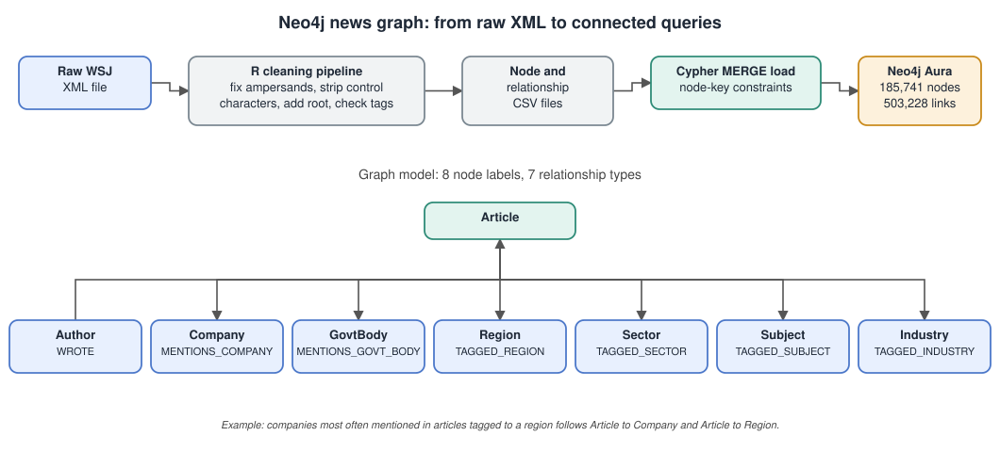

# Neo4j Graph Database for News Analytics

## The problem

A news archive is full of connections: authors write articles, articles mention companies, and articles are tagged with regions, industries and subjects. Questions such as "which companies appear most often in coverage of a given region" or "which authors write across the most industries" depend on those connections. In a relational database each of them needs several joins. This project models the Wall Street Journal collection (over 170,000 articles, 1990 to 1992) as a graph so that these questions become short queries.

## Architecture

## What was built

- **Data preparation in R.** The raw WSJ file is loose XML. A cleaning pipeline repairs unescaped ampersands, removes control characters, wraps the content in a single root element, parses it with `xml2` and checks that opening and closing tags match, then writes node and relationship CSV files.
- **Property graph in Neo4j Aura.** 185,741 nodes across 8 labels and 503,228 relationships across 7 types, loaded with Cypher `MERGE` statements and protected by node-key constraints.
- **Database selection.** The report compares a graph database with PostgreSQL junction tables and MongoDB, and explains why the graph model fits this data.
- **Example analyses written in Cypher:**
  - companies most often mentioned in articles for a given region
  - authors with the broadest industry and subject coverage
  - author profiles by topic over the 1990 to 1992 window
  - pairs of market sectors that appear together
  - government bodies with the most coverage, and which authors drive it

## Files

- [`project-report.pdf`](project-report.pdf): dataset analysis, schema, design rationale, query examples and the import and preprocessing scripts.

## Tools

R · xml2 · Neo4j Aura · Cypher
